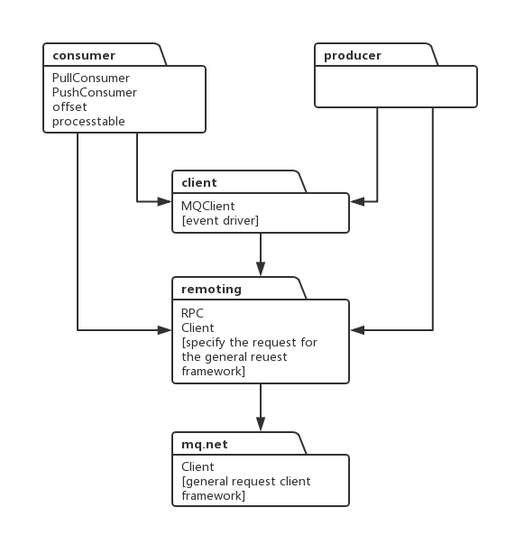

## package

### consumer

Consumer.

The base class `consumer` encapsulates common methods for push and pull consumption models.

Periodically synchronizes changes to consumption queues. In Clustering consumption mode, it is referred to as load balancing, while in Broadcasting mode, it is referred to as queue updating.

### producer

Producer.

### client

Primarily manages registered producers and consumers. It mainly performs three tasks:

1. Periodically updates routing information.
2. Periodically sends heartbeats to brokers and removes offline broker node information.
3. Periodically saves consumption progress information.

Each `clientID` corresponds to a client instance.

### remote

A generic RPC framework. Encapsulates encoding/decoding, and supports timeout, synchronous, asynchronous, and one-way requests.
